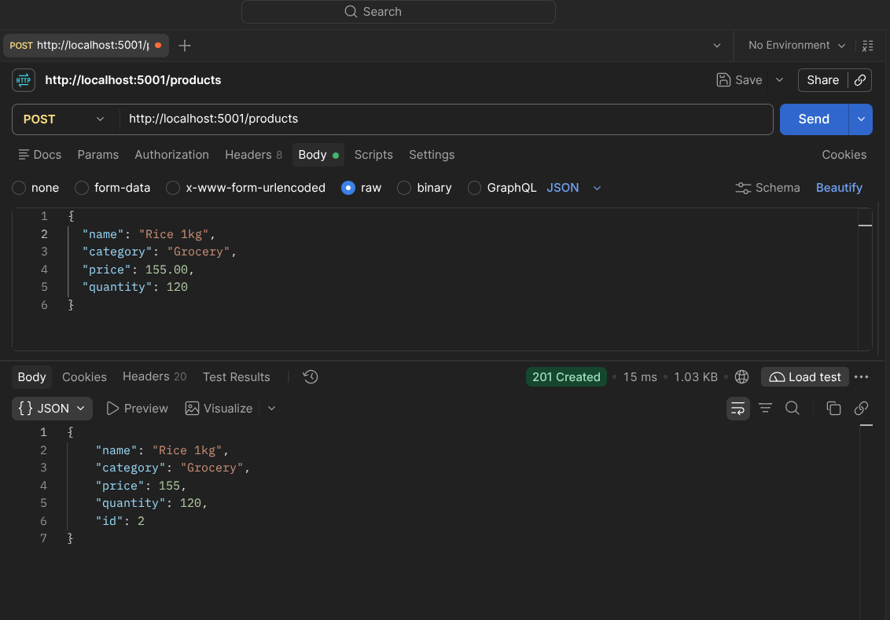
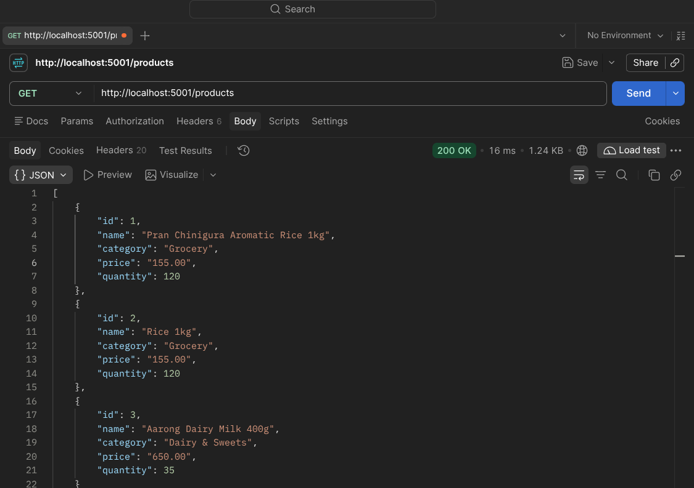
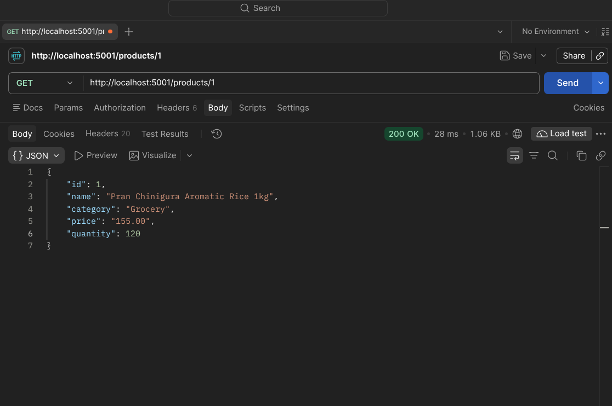
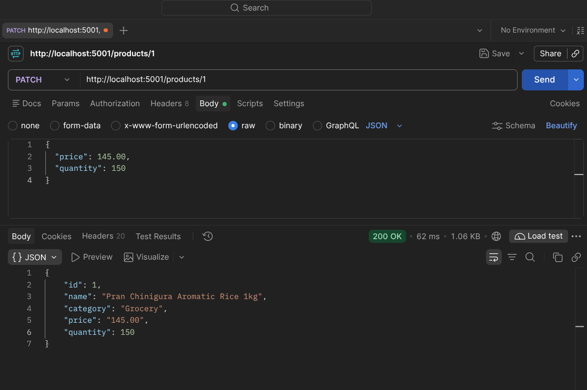
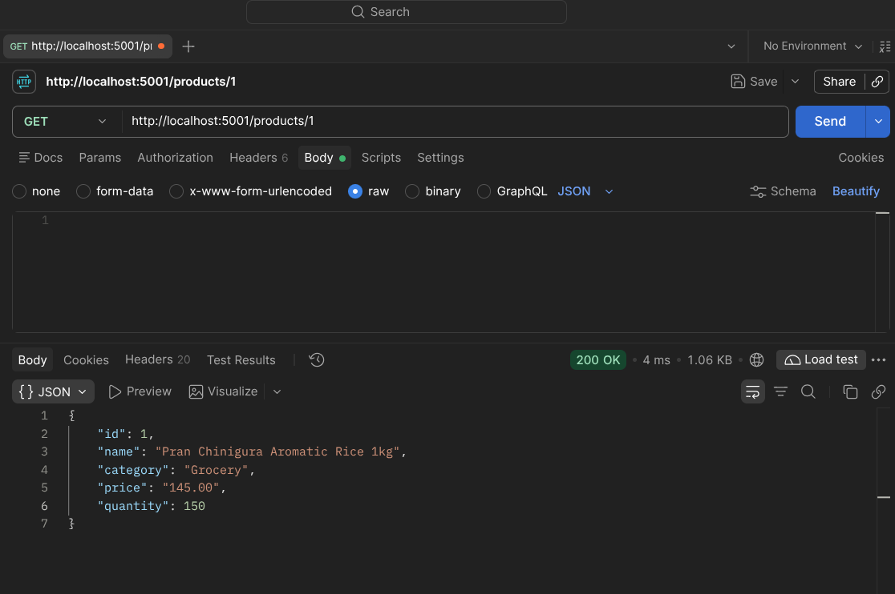
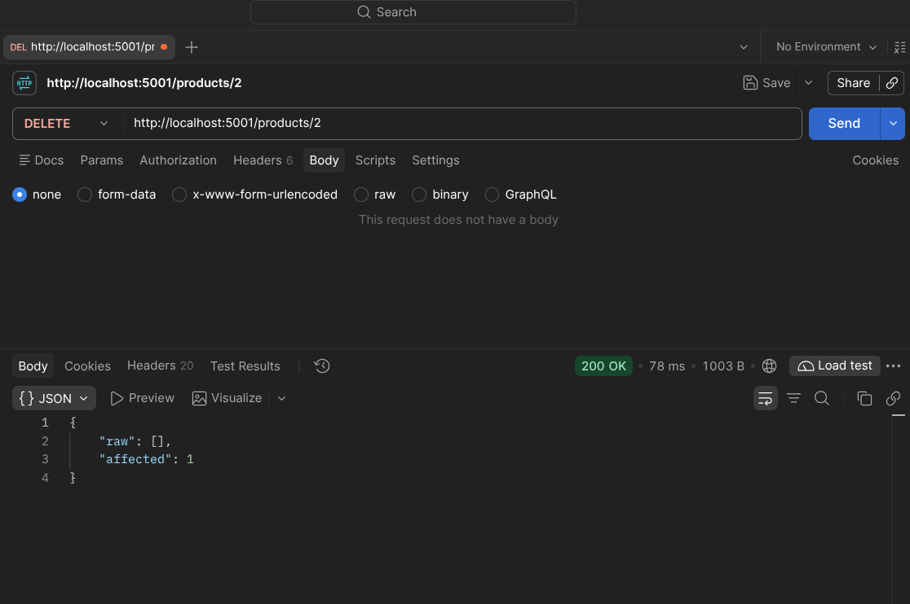
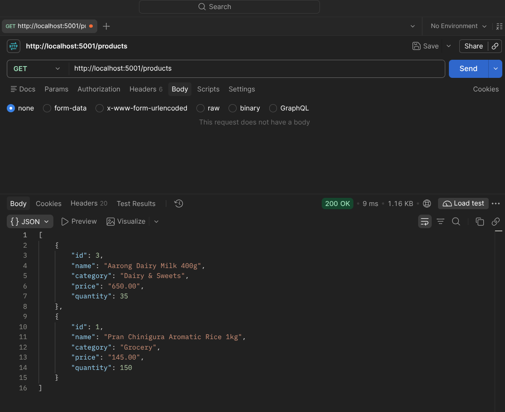

# Lab Task 1 – Product & Employee Management API

## 👨‍🎓 Student Details
- **SL:**
- **Name:** MD TANVIR RAHMAN
- **Student ID:** 23-51455-1
- **Section:** B

---

## 📌 Project Overview
A complete RESTful backend service built using **NestJS**, **TypeORM**, and **PostgreSQL** for managing store products and employees. This project fulfills all requirements specified in **Lab Task 1**, following enterprise modular architecture, Data Transfer Objects (DTOs), TypeORM entities, Promise-based database operations, and TypeORM database migrations viewable in **pgAdmin 4**.

---

## 🛠️ Tech Stack & Architecture
- **Framework:** NestJS (Node.js TypeScript)
- **Database:** PostgreSQL (managed with pgAdmin 4)
- **ORM:** TypeORM
- **Validation:** `class-validator`, `class-transformer`
- **Documentation:** Swagger / OpenAPI UI at `/api`

### Directory Structure
```
product-management/
├── screenshots/                     # Postman execution screenshots
│   ├── 01-create.png
│   ├── 02-get-all.png
│   ├── 03-get-by-id.png
│   ├── 04-update.png
│   ├── 05-confirm-update.png
│   ├── 06-delete.png
│   └── 07-confirm-delete.png
├── src/
│   ├── database/
│   │   └── migrations/              # TypeORM database migrations
│   │       └── 1730592000000-CreateProductsAndEmployeesTables.ts
│   ├── modules/
│   │   ├── products/
│   │   │   ├── dto/
│   │   │   │   ├── create-product.dto.ts
│   │   │   │   └── update-product.dto.ts
│   │   │   ├── entities/
│   │   │   │   └── product.entity.ts
│   │   │   ├── products.controller.ts
│   │   │   ├── products.service.ts
│   │   │   └── products.module.ts
│   │   └── employees/
│   │       ├── dto/
│   │       │   ├── create-employee.dto.ts
│   │       │   └── update-employee.dto.ts
│   │       ├── entities/
│   │       │   └── employee.entity.ts
│   │       ├── employees.controller.ts
│   │       ├── employees.service.ts
│   │       └── employees.module.ts
│   ├── app.module.ts
│   └── main.ts
├── .env.example
├── package.json
└── README.md
```

---

## 🗄️ Database Setup & Migrations (PostgreSQL & pgAdmin 4)

### 1. Create Database
Using PostgreSQL CLI (`psql`) or pgAdmin 4:
```sql
CREATE DATABASE product_management;
```

### 2. Configure `.env`
Copy `.env.example` to `.env` and verify database credentials:
```bash
cp .env.example .env
```
Ensure your database parameters in `.env`:
```env
DB_CLIENT=postgres
DB_DATABASE=product_management
DB_USER=postgres
DB_PASSWORD=123456
DB_HOST=localhost
DB_PORT=5432
PORT=5001
```

### 3. Run Database Migrations
Run the TypeORM migration command to create the `products` and `employees` tables:
```bash
pnpm migration:run
# or
npm run migration:run
```

### 4. Viewing in pgAdmin 4
1. Open **pgAdmin 4** and connect to your PostgreSQL server.
2. Expand **Databases** → **product_management** → **Schemas** → **public** → **Tables**.
3. You will see:
   - `products` (columns: `id`, `name`, `category`, `price`, `quantity`)
   - `employees` (columns: `id`, `name`, `email`, `phone`, `password`, `age`, `years_of_working`)
   - `migrations` (tracks migration history)
4. Right-click any table and choose **View/Edit Data** → **All Rows** to inspect records in real-time.

---

## 🚀 Installation & Running

### Install Dependencies
```bash
pnpm install
# or
npm install
```

### Run in Development Mode
```bash
pnpm start:dev
# or
npm run start:dev
```

### Build for Production
```bash
pnpm build
pnpm start:prod
```
The server will run at: `http://localhost:5001`
Swagger Documentation is available at: `http://localhost:5001/api`

---

## 📸 Postman Screenshots Evidence

### 1. Create Product (`POST /products`)t
- **Filename:** `screenshots/01-create.png`
- **Evidence:** POST request body and saved product response (`201 Created`).



---

### 2. Get All Products (`GET /products`)
- **Filename:** `screenshots/02-get-all.png`
- **Evidence:** GET response showing at least two products (`200 OK`).



---

### 3. Get Product by ID (`GET /products/:id`)
- **Filename:** `screenshots/03-get-by-id.png`
- **Evidence:** GET response for one actual product ID (`200 OK`).



---

### 4. Update Product Details (`PATCH /products/:id`)
- **Filename:** `screenshots/04-update.png`
- **Evidence:** PATCH request body and successful update response (`200 OK`).



---

### 5. Confirm Product Update (`GET /products/:id`)
- **Filename:** `screenshots/05-confirm-update.png`
- **Evidence:** GET by ID verifying the changed values (`200 OK`).



---

### 6. Delete Product (`DELETE /products/:id`)
- **Filename:** `screenshots/06-delete.png`
- **Evidence:** DELETE request and successful response (`200 OK`).



---

### 7. Confirm Product Deletion (`GET /products`)
- **Filename:** `screenshots/07-confirm-delete.png`
- **Evidence:** GET all showing that the deleted product is absent (`200 OK`).


